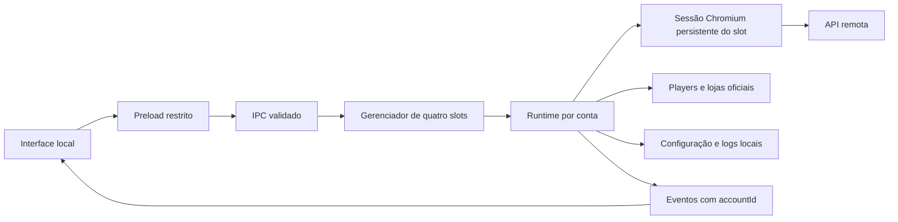

# Estado atual — Twitchterino

Levantamento do código existente, sem proposta de substituição tecnológica e sem alteração do produto.
Versão `0.1.5`; checkout de origem `622386ccd1d511814d3a77c8e96c06f10c509007`; binário publicado a partir de `a0942c6bb25a6a142fdab5a09c4b199a5b698e00`.
Captura: 2026-11-11T23:37:06-04:00 (America/Manaus).

**Leitura das evidências:** “implementado” significa encontrado no código; “teste” significa exercitado pelo cenário descrito; “observação histórica” vem de registro anterior; “a medir” não é uma conclusão de desempenho. Comentários e estimativas da plataforma não são garantias atuais de crédito de pontos.

## 1. Arquitetura executável

Electron **45.2.1**, JavaScript CommonJS no processo principal/preload e JavaScript/HTML/CSS sem framework na interface. Node **>=22.13.0** declarado; testes desta captura em Node **24.22.1**. Empacotamento por electron-builder **26.18.0**. Não há dependência de produto em `dependencies`, backend próprio ou banco de dados relacional; o runtime Node/Chromium é fornecido pelo Electron. Há dependências transitivas de desenvolvimento no lockfile e override versionado de minimatch. As versões exatas de Chromium/Node embutidas no binário não foram extraídas neste levantamento; registrar process.versions na futura instrumentação, sem confundir Node usado nos testes com Node embarcado.

Os quatro runtimes são **closures no mesmo processo principal**, não quatro executáveis nem quatro servidores Node. Uma `BrowserWindow`/partição não corresponde necessariamente a um único processo do SO; renderers, GPU e utilitários são gerenciados pelo Chromium.

| Unidade | Responsabilidade e fonte |
| --- | --- |
| Shell | [main.js](../../main.js): flags de execução, perfil, instância única, janela, bandeja, autostart, política de navegação e IPC global |
| Gerenciador | [account-manager.js](../../account-manager.js): IDs fixos, seleção ativa, contexto de argumentos, despacho que captura runtime antes de await e snapshot agregado |
| Runtime | [account-runtime.js](../../account-runtime.js): configuração, autenticação, polling, estado por canal, players, lojas, relatórios e timers |
| Transporte/segurança | [security/requests.js](../../security/requests.js), [security/platform.js](../../security/platform.js), [security/ipc.js](../../security/ipc.js), [security/accounts.js](../../security/accounts.js), [security/account-view.js](../../security/account-view.js) |
| Interface | [preload.js](../../preload.js), [renderer/index.html](../../renderer/index.html), [renderer/renderer.js](../../renderer/renderer.js); CSS base/features/theme, carregado nessa ordem |

## 2. Inicialização e encerramento

1. Aplica flags que evitam suspensão/throttling de mídia em segundo plano e `--max-semi-space-size=1` (não é limite de RAM total).
2. Resolve `--twitchterino-data=...` ou `TWITCHTERINO_DATA`, senão usa `app.getPath('userData')` padrão. Remove identificação Electron/app do User-Agent.
3. Constrói quatro runtimes; registra handlers autenticados e adquire o lock de instância única. Sem lock, encerra sem inicializar janelas do produto.
4. No ready, cria uma UI de 1380×900 (mínimo 820×620), bandeja e inicia **os quatro** runtimes, mesmo vazios. Cada um lê/grava config e cria uma janela de login inicialmente em robots.txt. Espera `apiReady` antes do primeiro `poll`; abre IRC de leitura em todos os quatro runtimes.
5. Fechar a UI a esconde; o trabalho continua. Segunda abertura foca a instância existente. `--hidden` inicia sem mostrar a UI.
6. `resume` do SO encerra players de coleta não mostrados manualmente e tenta novo poll após 15 s. `Sair` dispara stop em todos os runtimes e encerra o app.

[main.js · const ownsProfile](../../main.js#L121) e [account-runtime.js · function start(](../../account-runtime.js#L1488) são as entradas para reproduzir o ciclo de vida.

## 3. Sessão, conta e isolamento

| Slot | Partição persistente | Configuração relativa a userData |
| --- | --- | --- |
| account-1 | `persist:twitch` | `config.json` |
| account-2 | `persist:twitch-account-2` | `accounts/account-2/config.json` |
| account-3 | `persist:twitch-account-3` | `accounts/account-3/config.json` |
| account-4 | `persist:twitch-account-4` | `accounts/account-4/config.json` |

Cookies, cache e armazenamento web pertencem à sessão Electron da partição; não são campos do JSON de configuração. O primeiro slot reutiliza o perfil instalado anterior. Mudar slot seleciona dados/controles, não transporta cookies nem troca um token global.

`auth-token` alterado → invalida geração e envio IRC, marca verificação → debounce de 100 ms → relê o cookie efetivamente selecionado. Mesmo digest já verificado conserva identidade/baseline; token novo é reverificado pelo GraphQL. Identidade usa `id:` se houver ID numérico, senão `login:` em minúsculas. `sessionTransition`, geração e identidade protegem o trabalho assíncrono; o estado `sessionChecking` pode preservar players já existentes enquanto verifica. Logout suspende cliente, cancela lojas/baús/players, fecha IRC autenticado, limpa a sessão e volta a permitir consultas. IRC de leitura pode permanecer.

O gerenciador inicia selecionando account-1; reload da UI sincroniza sua seleção com o estado retornado pelo main. Não há gravação explícita da seleção ativa no config. Popups herdam a sessão da janela de origem. O namespace da ponte é `window.tt`.

## 4. Integrações efetivamente usadas

| Integração | Contrato implementado |
| --- | --- |
| API do aplicativo | `POST https://gql.twitch.tv/gql` via sessão do slot; grupos de até 10 canais por consulta, usuário atual no primeiro grupo |
| Autenticação | Cookies `auth-token` e `unique_id`; cabeçalhos OAuth e dispositivo construídos no processo principal; Client-ID público fixo no código, sem OAuth próprio registrado neste fork |
| Chat recebido | `wss://irc-ws.chat.twitch.tv:443`, conexão anônima por runtime, JOIN dos canais configurados |
| Chat enviado | Outra conexão IRC, autenticada e criada sob demanda na primeira mensagem |
| Páginas remotas | Login `/login`, página de canal `/{slug}`, loja/baú `/popout/{slug}/chat?popout=`, página leve `/robots.txt` |
| Mídia | Playlists `.m3u8` da página real, interceptadas por CDP; emotes em `static-cdn.jtvnw.net`; avatar vem da API |
| Parceiros | `https://viinnisantoos.github.io/twitchterino/parceiros.json`: configuração pública, no máximo 60 slugs válidos por leitura; não é feed de executáveis |

O fork depende de APIs internas, DOM e mídia da plataforma. A lista de URLs acima não é a lista completa dos hosts que uma página real pode carregar; CDNs e provedores de login são dependências transitivas do navegador. O módulo platform contém código para ambas as plataformas, mas este app instancia somente `twitch`.

## 5. Fronteiras de segurança

- Consultas do aplicativo usam `session.fetch` no main, com cookies da partição, sem inserir credenciais em `executeJavaScript`. Páginas oficiais administram seus próprios logins/cookies e requisições.
- Destino do cliente restrito, redirects recusados, timeout que aborta requisição de **20 s**, limite de resposta **2 MiB**, mensagens de erro sanitizadas e invalidação por geração. Esses limites pertencem ao cliente do aplicativo; **não** limitam toda a navegação, vídeo, CDP ou WebSocket.
- IPC exige o `webContents` da UI atual, seu frame principal vivo e URL local exata. Validação de argumentos vem antes de efeitos.
- Preload só expõe a ponte no frame principal e documento esperado por `--app-ui-url`. UI usa `contextIsolation`, sandbox e `nodeIntegration:false`. Páginas remotas não recebem esse preload.
- Navegação/popups da UI bloqueados; janelas de plataforma aceitam somente hosts HTTPS da lista em main (e about:blank). Lista: Twitch, Apple, Facebook, Amazon, Google e accounts.youtube.com.
- Permissões das sessões limitadas a fullscreen e escrita sanitizada na área de transferência. Bloqueio de rastreadores usa correspondência por substring; não constitui garantia de bloquear todos os anúncios.
- O pacote configura fuses: cookie encryption, RunAsNode desligado, variáveis/opções de inspeção Node desligadas e carga de app restrita ao ASAR. Não há atualização automática nem assinatura digital do instalador.

## 6. Modelo persistido e estado transitório

| Dado | Formato/local | Uso e limitações |
| --- | --- | --- |
| Preferências | `config.json`, escrita JSON síncrona no main | Merge superficial sobre defaults; não há schema versionado completo, escrita atômica nem mecanismo de backup do config no código |
| Canais | `channels:string[]`, `seenDefaults:string[]`, `favorites:string[]` | Cada slot tem lista própria; parceiros novos entram uma vez; remover canal já visto evita reinserção automática |
| Ganhos | `daily:{YYYY-MM-DD:number}` | Somatório de diferenças positivas de saldo, em data local do PC; não prova origem exclusiva em assistir |
| Compras | `{t,kind,hours,slug,cost}` | Detecção descrita nas regras; retenção de compras de 10 dias aplicada ao registrar novas compras |
| Identidade de relatório | `reportAccount:string`, `accountReports:array` | Primeira identidade verificada adota legado; mudança arquiva/restaura relatórios por identidade; sem limite global de arquivos lógicos arquivados |
| Extras | `chestDaily`, `chestsClaimed`, `lastSeenVersion`, `limitResult` | Chaves auxiliares criadas conforme uso |
| Histórico | `points-log.jsonl`, no diretório do slot | Append síncrono por poll concluído; tenta rotacionar acima de 5 MiB para `.old`, com erros de log suprimidos; não é amostragem garantida a cada minuto |
| Baús | `chest-log.jsonl`, tenta rotacionar acima de 1 MiB para `.old` | Duração, canal e resultado de tentativa; não tokens |
| UI | `localStorage`: `offlineOpen`, `panelOpen` | Preferências visuais da UI compartilhada, não uma base por identidade |
| Estado em memória | Mapas de canais/janelas, ganhos da sessão, timestamps, filas, timers, buffers de chat | Não persistidos; reinício recria referências de saldo, aquecimento, fila e estado de execução |

O relatório de sete dias calcula cobertura por amostragem minuto a minuto e 48 blocos de 30 min para as últimas 24 h. `bonusHours` é cobertura de qualquer bônus, não soma de horas simultâneas de todos os tipos. Exportação usa captura do card da UI e diálogo nativo para salvar PNG.

## 7. Contrato IPC e eventos

Entradas globais registradas por main: `state:get`, `account:select(id)`, `account:command({accountId,command,args})`, `autostart:set(bool)`, `app:quit`. O envelope de conta não aceita comandos globais ou recursivos. Retorno de comando: `{accountId,result}`; snapshots adicionam `accountId` e `accounts[]` sem cookies/tokens.

| Comandos de conta | Argumentos aceitos / efeito |
| --- | --- |
| `channels:add/remove`, `favorite:toggle` | Slug normalizado no add; remove/favorito exigem canal conhecido |
| `farming:set`, `rotation:set`, `lowQuality:set`, `notifyBonus:set`, `notifyChat:set`, `sleepMode:set` | Booleanos estritos; mudanças persistidas no slot |
| `watchAll:set`, `autoChest:set`, `notifyChest:set` | Booleanos; todas as lives/baús conforme regras |
| `maxWatchers:set` | Inteiro 1–10; validador também admite string decimal compatível com input numérico |
| `bonusTarget:set`, `purchase:add/remove` | Alvo vazio ou xp/capture/lure com 1/3/5/10 h; compra manual aceita tipo e registra 1 h; remoção por timestamp positivo |
| `stores:sequence/cancel`, `store:open`, `channel:show` | Fila até 100 slugs únicos conhecidos; loja e player vinculados ao slot |
| `limitTest:start/stop`, `refresh`, `login:show`, `logout`, `intro:done`, `report:get` | Sem argumentos; logout tem confirmação nativa |
| `chat:send` | Objeto com destino conhecido e conteúdo não vazio de até 500 caracteres; CR/LF normalizados |
| `report:save` | Retângulo finito, arredondado, dentro do viewport; área máxima 64×1024×1024 pixels |

Eventos: `status` transmite snapshot selecionado agregado; `chat` e `select` carregam `{accountId,payload}` e só são encaminhados ao slot exibido; `account:activate` pede ativação da conta de origem da notificação/bandeja. Há também `toast` para baú confirmado. A ponte captura o ID ao chamar cada ação; `account-view` usa época da seleção e rejeita promessas antigas, inclusive A→B→A. Isso não é uma API pública para serviços externos.

## 8. Interface e recursos do SO

Canais laterais com busca/fixados/offline, chat central, quatro seletores, gaveta de configurações e painel de bônus. Recriação imperativa do DOM em snapshots; até **400 nós/mensagens por canal** nos buffers, sem paginação global; limpar seleção de conta descarta buffers anteriores. Emotes são imagens remotas, sem interpolação de HTML do chat. Notificações de menção/sorteio usam renderer; bônus usam Notification do main.

Autostart no Windows usa registro via Electron e `--hidden`; perfis alternativos recebem argumento de dados e nome derivado de hash. Linux usa arquivo `.desktop` de autostart; AppImage/variáveis de portable continuam como compatibilidade de código, embora a distribuição Windows vigente seja NSIS. Logs, animações CSS, confete e callbacks continuam no app; as diferenças de energia e de UI estreita constam no comparativo.
